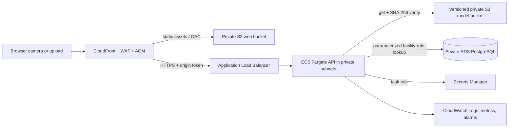

# RION AWS deployment architecture

## Status

This is deployable Terraform and container configuration. It has **not** been applied to an AWS account, and no AWS resources have been created. Deploying the stack creates billable CloudFront/WAF, ALB, ECS/Fargate, RDS, S3, CloudWatch, and VPC endpoint resources. Review the plan and estimate costs before applying it.

## Service map from the project brief

| Need | AWS service | RION configuration |
|---|---|---|
| Public HTTPS edge | Amazon CloudFront, AWS WAF, AWS Certificate Manager | CloudFront serves the React bundle from a private S3 origin, routes `/api/*` and `/health` to the API origin, uses a WAF managed rule set and per-IP rate rule, and uses DNS-validated ACM certificates. The CloudFront ACM certificate is created in `us-east-1`. |
| API hosting | Amazon ECS on AWS Fargate behind an Application Load Balancer | FastAPI runs in private subnets. The public ALB accepts TLS only from CloudFront's origin-facing prefix list. CloudFront adds a runtime-secret origin token which the API validates. |
| Model artifacts | Private Amazon S3 | Terraform uploads the trained YOLO detector and category classifier under `models/`, enables S3 versioning, blocks public access, and uses server-side encryption. The ECS task role can read only that model prefix. The API verifies each downloaded checkpoint against a SHA-256 value. |
| Database | Amazon RDS for PostgreSQL | RDS is in private database subnets and accepts port 5432 only from the API task security group. It stores facility material-routing rules, not images. SQLAlchemy uses named parameters. |
| Access and secrets | AWS IAM roles, AWS Secrets Manager | Separate ECS task and execution roles. The runtime task role reads model objects and one Secrets Manager JSON secret containing the DB URL and origin token; no static AWS keys are configured. |
| Monitoring | Amazon CloudWatch | ECS sends structured application logs to a retained log group; Container Insights, an operations dashboard, and ALB 5xx/ECS CPU alarms are configured. |

Other supporting resources are a private ECR repository for the API image, Route 53 records, a VPC, public ALB and private app/database subnets, restrictive security groups, and VPC endpoints for ECR, S3, Logs, and Secrets Manager. The private tasks do not use a NAT gateway.



## Deploy prerequisites

- An AWS account and a configured AWS CLI profile with permission to manage the named services. Use an IAM Identity Center or other short-lived role session, not long-lived keys in project files.
- Terraform 1.10+, Docker Buildx, AWS CLI v2, Node.js/npm, and Python for the local training/build steps.
- A public Route 53 hosted zone and control of `app_domain_name` and `api_domain_name` under that zone. Terraform requests both ACM certificates and completes DNS validation.
- The trained files `models/material-yolo.pt` and `models/rion-classifier.pt`. The second file is created by the classifier training step in the README.
- A protected Terraform state backend. Terraform state includes database credentials and the CloudFront origin token. Do not commit `terraform.tfstate`, plan files, or `terraform.tfvars`.

## Deployment outline

Run commands from the RION project root unless the command changes directory.

1. Build the frontend and copy the Terraform variable template:

   ```powershell
   cd frontend
   npm ci
   npm run build
   cd ..\infra\aws
   Copy-Item terraform.tfvars.example terraform.tfvars
   ```

   Edit `terraform.tfvars` with the AWS region, the two RION domain names, the existing Route 53 zone, and a temporary nonempty `api_image_uri` for the bootstrap step. The example contains placeholder domains and values.

2. Initialize Terraform and create only the private ECR repository for the initial image push:

   ```powershell
   terraform init
   terraform apply -target=aws_ecr_repository.api -var-file=terraform.tfvars
   $ecr = terraform output -raw ecr_repository_url
   ```

   Configure an encrypted remote state backend before this step for a shared or production deployment. The target apply is only an image-repository bootstrap; the full stack is applied later.

3. Build and push an immutable API image. Use a unique release tag, not `latest`:

   ```powershell
   $region = "ap-south-1"
   $tag = "release-20261011-1"
   aws ecr get-login-password --region $region | docker login --username AWS --password-stdin ($ecr.Split('/')[0])
   cd ..\..
   docker buildx build --platform linux/amd64 -f backend/Dockerfile -t "$ecr`:$tag" --push .
   cd infra\aws
   ```

   Set `api_image_uri` in `terraform.tfvars` to the pushed immutable image URI.

4. Review and apply the full stack:

   ```powershell
   terraform plan -var-file=terraform.tfvars -out=rion.tfplan
   terraform show rion.tfplan
   terraform apply rion.tfplan
   ```

   Terraform requests the ACM certificates and Route 53 validation records, then provisions the edge, buckets, VPC, database, API service, IAM/secrets, and monitoring. The RDS instance has deletion protection enabled by default.

5. Upload the static frontend and invalidate the CloudFront cache:

   ```powershell
   $webBucket = terraform output -raw frontend_bucket_name
   aws s3 sync ..\..\frontend\dist "s3://$webBucket" --delete
   $distribution = terraform output -raw cloudfront_domain_name
   aws cloudfront list-distributions
   ```

   Copy the distribution ID from the `list-distributions` output and invalidate it:

   ```powershell
   aws cloudfront create-invalidation --distribution-id DISTRIBUTION_ID --paths "/*"
   ```

   The model files are uploaded to the separate versioned model bucket by Terraform, and the task receives their local SHA-256 digests. The backend uses its ECS task role to retrieve the model and runtime secret.

6. Initialize/seed the RDS policy table with the project's **illustrative** examples. This launches a one-off Fargate task in the private subnets; it does not enable interactive ECS Exec. Create `work/rion-seed-override.json`:

   ```json
   {"containerOverrides":[{"name":"rion-api","command":["python","scripts/seed_policy_db.py"]}]}
   ```

   Then run the task using values printed by Terraform:

   ```powershell
   $cluster = terraform output -raw ecs_cluster_name
   $taskDefinition = terraform output -raw ecs_task_definition_arn
   $subnets = (terraform output -json ecs_private_subnet_ids | ConvertFrom-Json) -join ","
   $securityGroup = terraform output -raw ecs_security_group_id
   aws ecs run-task --cluster $cluster --task-definition $taskDefinition --launch-type FARGATE --network-configuration "awsvpcConfiguration={subnets=[$subnets],securityGroups=[$securityGroup],assignPublicIp=DISABLED}" --overrides file://../../work/rion-seed-override.json
   ```

   Check the one-off task's exit code and `/aws/ecs/rion/api` logs. Replace every example rule with a facility-reviewed record and source before production use.

7. Verify `https://<app_domain_name>/health` reports the API and model as available, then try a one-item webcam scan and image upload. The browser uses same-origin `/api/...` requests through CloudFront. Confirm ALB target health, ECS logs, WAF metrics, and the CloudWatch dashboard.

## Security and operations notes

- The S3 web origin uses CloudFront Origin Access Control; both buckets block public access. The model bucket is versioned and its artifacts are checksum-verified after download.
- RDS is not public and contains material-route policy data only. The supplied seed values are examples. A facility review must replace them before a real sorting recommendation is shown.
- The ALB security group accepts only CloudFront origin-facing traffic; the API also checks a random token injected by CloudFront and read from Secrets Manager via the ECS task role. `/health` is deliberately available for ALB health checks and exposes only service/model readiness.
- CloudFront's WAF rule limits each source IP to 1,200 requests per five minutes. Review this against webcam frame frequency and expected shared-NAT traffic before a pilot.
- S3 versioning preserves old model artifacts but is not a model registry approval process. Review model cards, test reports, and SHA-256 values before uploading a new release.
- CloudWatch stores API logs and metrics. The app never writes webcam image bytes to S3 or PostgreSQL. Keep logs free of image payloads and secrets.
- ECS tasks have no general outbound internet path. They reach AWS dependencies over private VPC endpoints. Model and data downloads for retraining remain a controlled developer/CI step.
- The configured Fargate, RDS, load balancer, CloudFront/WAF, S3, and VPC endpoint resources incur charges. For a disposable environment, empty both buckets, disable RDS deletion protection deliberately, preserve any required final snapshot, and inspect the Terraform destroy plan before removal.

The resources in this directory are a proposed deployment implementation; they do not mean the AWS services have been created or tested in an account.
