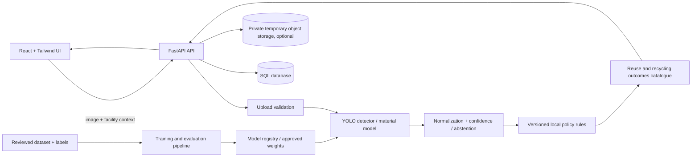

# RION — Resource Intelligence & Optimization Network

## Project plan and outline

**Document status:** Planning blueprint accompanying the runnable starter project  
**Prepared:** 11 October 2026  
**Proposed product:** RION detects visible objects in webcam frames or uploaded images, estimates broad item/material categories, and provides location- and facility-specific guidance: recyclable, reusable, refuse processing, or needs review.

## 1. Summary

Build a computer-vision-assisted material guidance system with a React web client, a Python API, a YOLO-based object detector, and a versioned rules catalogue for local recycling and reuse guidance. The model identifies likely object/material labels; a separate policy layer determines the recommended route for the selected municipality or facility. A curated knowledge base explains possible recycling outputs and practical reuse options.

The MVP is a decision-support tool. It must show uncertainty and ask for human review when an image is ambiguous, an item is composite or contaminated, or the configured facility has no reliable rule. It must not present a generic material label as a guarantee that a local facility accepts an item. The current two-stage Kaggle prototype covers broad waste categories; rubber, alloy identity, and exact plastic resin codes are still unsupported.

## 2. Goals and boundaries

### MVP goals

- Accept a still image from a browser and return detected item regions, likely object/material classes, confidence, and an explainable recommendation.
- Cover steel/ferrous metal, aluminum, rubber, glass, paper/cardboard, and common plastic resin families: PET (1), HDPE (2), PVC (3), LDPE (4), PP (5), PS (6), and other/mixed plastics (7), plus composite and unknown classes.
- Return one of four route outcomes: **recyclable**, **reusable**, **refuse processing**, or **needs review**.
- Explain which local rule and facility profile produced the route, and show the rule's source and last-verified date.
- Offer vetted examples of products that recycling feedstock can become and safe reuse suggestions.
- Provide a data correction path so users or reviewers can flag wrong detections and stale local rules.
- Keep model results, policy decisions, and user-facing explanation as separate, auditable steps.

### Out of scope for the first release

- Autonomous control of conveyor belts, robotic sorting, or hazardous-material handling.
- Guaranteeing resin type from an image when no resin mark or reliable visual cue is present.
- Treating model confidence as proof that an item is clean, safe, or accepted by every recycler.
- Giving hazardous-waste, food-contact, medical, or chemical-safety advice without a reviewed source.
- Broad recycling coverage before a named pilot region and its facility rules have been verified.

## 3. Important product rules

1. **Material identification and route are separate.** For example, an object may appear to be PET while the chosen facility does not accept that item format.
2. **Policy is local and time-bound.** Every route lookup is keyed by jurisdiction and, where possible, facility/stream. Rules include source URL, effective date, review date, and version.
3. **Uncertainty is not refusal.** Low confidence, an unknown class, or conflicting rules produces `needs_review`; `refuse_processing` means an explicit configured policy rejects that item from that stream.
4. **A photo cannot reveal every important property.** Contamination, black plastics, coatings, labels, mixed materials, and resin codes may need another image or user confirmation.
5. **Reuse suggestions are conditional.** Show cleaning/condition caveats and do not suggest reuse where contamination, sharp edges, chemicals, or food-contact risks are plausible.
6. **Recycling outputs are examples, not promises.** Feedstock quality, local processes, and markets determine whether a material becomes a given product.

## 4. Users and core workflow

### Primary users

- Residents or staff who need an item-by-item disposal recommendation.
- Facility operators who maintain accepted-material rules and review uncertain cases.
- Project administrators who manage model releases, policy sources, and audit records.

### User journey

1. Select jurisdiction/facility or confirm a detected default location.
2. Upload or capture a clear image of one or more items.
3. Review marked detections and correct an item label if needed.
4. See material estimate, confidence, route, concise reason, and facility/source information.
5. Open reuse ideas or possible recycled products, with conditions and caveats.
6. Submit an optional correction; corrections enter a reviewed data queue, not the training set automatically.

### Example response contract

```json
{
  "request_id": "opaque-id",
  "model_version": "detector-0.1.0",
  "policy_version": "facility-example-2026-10-01",
  "detections": [
    {
      "box": {"x1": 0.12, "y1": 0.14, "x2": 0.78, "y2": 0.91},
      "object_label": "drink_bottle",
      "material": "PET",
      "confidence": 0.91,
      "route": "recyclable",
      "reason": "This facility accepts empty PET bottles in its container stream.",
      "needs_review": false,
      "policy_source": {"title": "Facility accepted materials", "url": "https://example.org/rules", "reviewed_at": "2026-10-01"},
      "possible_outputs": ["fiber", "new packaging feedstock"],
      "reuse_ideas": ["Use for a non-food storage task only if clean and intact."]
    }
  ]
}
```

The example is illustrative; facility statements and reuse guidance must be populated from reviewed sources before pilot use.

## 5. Proposed system architecture



### Components

- **Web frontend:** React, TypeScript, Vite, and Tailwind CSS. Image preview, upload validation feedback, bounding-box overlays, result cards, facility selector, feedback form, accessibility and responsive layout.
- **API/backend:** FastAPI with typed request/response models. Endpoints for health, classification, policy catalogue, feedback, and administrator-only rule/model operations.
- **Inference:** Ultralytics YOLO for object localization; initially compare a detector with a two-stage detector-plus-material classifier. Use a calibrated confidence threshold and abstain when visual evidence is insufficient. Run CPU inference for development; add an approved accelerator deployment only after measuring demand and cost.
- **Policy engine:** Deterministic lookup on material + item type + condition/contamination answers + jurisdiction + facility stream. Rules are maintained separately from model weights.
- **Database:** SQLite for local development; PostgreSQL for a shared deployment. SQLAlchemy with parameterized ORM/Core access. Store policy metadata, model versions, reviewed corrections, and minimal inference audit data.
- **Storage:** The application should not persist images by default. Account for multipart parser temporary spooling as well as decoded in-memory processing; secure and clean the temporary directory. If retention is necessary, use private encrypted object storage, short retention, access logging, and explicit user notice.
- **Model operations:** Dataset manifest, reproducible train/validation/test splits, metrics, model artifact checksum, model card, approval gate, rollback path.

### Suggested API surface

| Endpoint | Purpose | Access |
|---|---|---|
| `GET /health` | Liveness/readiness and model availability | Public, no sensitive detail |
| `POST /api/v1/classifications` | Upload one image and request a route | Rate limited; authenticated if deployed for restricted users |
| `GET /api/v1/facilities` | List configured pilot facilities and streams | Public or authenticated per deployment |
| `GET /api/v1/materials/{id}/guidance` | Read vetted outcomes and reuse guidance | Public |
| `POST /api/v1/feedback` | Submit a correction for review | Rate limited; no automatic model update |
| Admin endpoints | Maintain rules, sources, accounts, model release | Strong authentication and role checks |

## 6. Data and model plan

### Label design

Maintain separate labels for:

- **Object:** bottle, can, tire/rubber item, packaging film, container, cable, textile-like composite, etc.
- **Visible material estimate:** steel/ferrous, aluminum, rubber, glass, paper/cardboard, resin family, composite/mixed, unknown.
- **Condition flags:** visibly soiled, food residue, broken/sharp, multilayer/composite, no visible resin mark, occluded, insufficient image.
- **Route label:** derived only from the reviewed local policy record, never inferred from an image label alone.

Use a hierarchical taxonomy so the system can return “plastic, resin unknown” rather than forcing a wrong resin label. Consider a separate segmentation model if overlapping objects or material area estimates are important; detection is adequate for the first image-based MVP.

### Candidate data sources and collection

- **TACO (Trash Annotations in Context):** candidate source for litter/object detection labels. Audit its label fit, image provenance, license/terms, class imbalance, and annotation quality before use.
- **Open Images:** candidate source for general object pretraining or selected object classes. It is not a substitute for material-specific, local waste imagery; inspect image-level licensing/attribution requirements and annotation definitions.
- **Pilot images:** collect consented, representative images from the target region/facilities with varied lighting, camera distance, backgrounds, item conditions, angles, and relevant local packaging. Get policy experts to review the materials and outcomes.
- **Facility rules:** gather accepted/rejected materials from official municipal/facility sources and record source, retrieval date, effective dates, stream, conditions, and reviewer. Resolve conflicting official sources before publication.

Do not mix policy labels into a generic vision dataset. Split image data by collection source/site/session (not near-duplicate image) to reduce leakage. Keep original data provenance and a dataset card. Review license and privacy before training or redistribution.

### Data preparation steps

1. Inventory source, license, permitted use, provenance, class definitions, and quality for each dataset.
2. Deduplicate exact and near-duplicate images; quarantine corrupted, low-resolution, or irrelevant files.
3. Normalize labels to a documented taxonomy; retain original labels and mapping history.
4. Annotate bounding boxes (and condition tags when visible); double-label a sample and adjudicate disagreements.
5. Build stratified, group-separated train/validation/test sets; keep a frozen final test set.
6. Track class balance, image-source balance, label agreement, and missing labels.
7. Augment training only; avoid transformations that make resin marks, labels, or contamination cues unreadable.

### Training and evaluation

- Establish a pretrained YOLO baseline, then fine-tune on reviewed custom labels. Compare model sizes and inference latency on target hardware.
- Evaluate detection with mAP at IoU thresholds, precision/recall per class, confusion matrices, and error slices by lighting, background, condition, and data source.
- Evaluate material classification separately with macro-F1, per-class precision/recall, calibration, and an abstention/unknown curve.
- Evaluate route correctness separately against the versioned rules database; this is a policy test, not a vision metric.
- Test image perturbations and out-of-distribution cases; manually inspect false confident classifications, especially for composites and hazardous/contaminated items.
- Set numeric launch gates with the pilot facility before training is considered production-ready. Do not claim a threshold until it has been measured on a held-out pilot set.

### Knowledge catalogue examples

The catalogue should explain **possible** recycling outputs, with process and local caveats. Examples to verify with local operators include steel becoming new steel products, aluminum becoming new aluminum products, selected PET becoming fiber or packaging feedstock, and clean cardboard becoming recycled paper products. For reuse, prioritize direct, practical options such as a sound container used for non-food storage or an intact tire used in a reviewed non-food application. Every entry needs conditions, exclusions, and a source/reviewer.

## 7. Multi-agent team and responsibilities

The five roles below are the delivery team roles requested for this project. A person may cover more than one role in a small team, but review gates should remain independent where practical.

| Role | Owns | Responsibilities and deliverables | Handoff / review |
|---|---|---|---|
| **AI/ML Expert** | Model and inference | Define taxonomy with Data Scientist; choose YOLO task/model; build training/inference pipeline; tune thresholds and calibration; evaluate model slices; publish model card, reproducible config, approved weights and rollback notes. | Gives Tester a frozen model/API contract and known failure cases; works with Web Developer on latency and response shape. |
| **Security Expert** | Threat model and release security | Threat-model uploads/API/admin paths; configure authentication/authorization, SQL injection protections, secret handling, least-privilege cloud IAM, network boundaries/firewalls, TLS, storage retention, rate limits, logging, dependency/image scanning, and incident/backup procedures. | Reviews architecture and deployment before pilot; verifies no unsafe file handling or exposed model/data bucket. |
| **Data Scientist** | Data quality and policy evidence | Find candidate datasets; record license/provenance; define annotation guide; clean/deduplicate/label data; manage group splits and balance; audit error slices; collect and verify facility rule sources and output/reuse claims. | Delivers dataset card, label mappings, curated policy sources, and data-quality report to AI/ML Expert and Tester. |
| **Tester** | Independent quality verification | Convert requirements into acceptance criteria; test API/UI, model outcomes, edge cases, accessibility, cross-browser behavior, performance, upload abuse, security regression, and rule changes; log reproducible defects and retest fixes. | Maintains test matrix and release sign-off; returns prioritized defect reports to all owners. |
| **Web Developer** | User experience and integration | Build React + Tailwind interface; implement upload, facility selection, overlays, route/explanation cards, feedback; connect frontend to typed API; manage npm dependencies/lockfile and accessible states; coordinate CORS and error handling. | Delivers UI/API integration to Tester; receives API schema and inference constraints from AI/ML Expert. |

### Collaboration cadence

- Weekly planning/review with one demonstrable increment and a risk/decision log.
- Shared contracts: label taxonomy, API schema, policy rule schema, dataset card, threat model, and acceptance test matrix.
- Every model, policy rule, dependency update, and production configuration change is versioned and reviewed.
- Tester is included from Phase 1; security and policy review happen before the pilot, not after launch.

## 8. Delivery roadmap and exit criteria

Indicative duration: **10–12 weeks** for a small team after the pilot jurisdiction and facility contact are available. Data access, annotation volume, and hardware can change this estimate.

| Phase | Indicative time | Main work | Exit criteria |
|---|---:|---|---|
| 0. Scope and policy discovery | 1 week | Choose pilot region, facility/stream, supported items, privacy assumptions, success metrics, and explicit refusal rules. | Approved item taxonomy, named policy owner, source list, and acceptance targets. |
| 1. Data and threat design | 1–2 weeks | Dataset/license audit, collection protocol, annotation guide, threat model, API/data schema. | Dataset card draft; no unresolved rights/privacy blockers; security review of upload flow. |
| 2. Data pipeline and baseline | 2–3 weeks | Clean/label/split images; train pretrained YOLO baseline; measure per-class performance and unknown behavior. | Reproducible baseline, frozen test set, error analysis and known limitations. |
| 3. API and policy service | 2 weeks | Inference endpoint, local rules catalogue, source versioning, response explanations, audit-minimal logging. | API contract passes unit/integration checks; rule decisions trace to sources; abstention works. |
| 4. Web app and integration | 2 weeks | Upload/review UX, overlays, facility selector, explanation cards, responsive/accessibility work. | End-to-end local workflow works on agreed browsers and normal image formats. |
| 5. Security, field test, release | 2 weeks | Abuse/security checks, pilot-user testing, threshold tuning, documentation, monitoring and rollback. | Tester sign-off; facility approves content; security review closed; launch/rollback runbook ready. |

## 9. Security and privacy controls

- Treat every upload as hostile: allow-list formats, validate decoded file signatures rather than trusting the browser MIME type, cap file size and dimensions, generate server-side names, decode safely, and reject malformed files. Avoid serving original uploads back from a public path.
- Use FastAPI/Pydantic validation; parameterized SQL through SQLAlchemy; allow-list sorting/filtering fields; least-privilege database roles; migrations reviewed before deployment.
- Enforce HTTPS/TLS at the edge; restrict inbound network rules to required ports; keep database and object storage private; use cloud IAM roles and short-lived credentials; separate dev/staging/production accounts or projects.
- Store secrets in environment-specific secret management, never in source control or frontend build variables. Add `.env.example` with placeholders only.
- Add authentication and role-based authorization for administrators; rate limit expensive inference; configure CORS for exact frontend origins; return generic errors without stack traces or secrets.
- Encrypt persisted data in transit and at rest; retain images only when explicitly needed and for a published period; minimize sensitive request logs; secure temporary upload storage and provide a deletion path.
- Pin and review dependencies; produce an SBOM for release; run static analysis and dependency/container scanning; patch supported dependencies; back up and test recovery.
- Configure firewall/network policy, WAF or equivalent edge controls when exposed publicly, alert on abnormal upload/inference patterns, and document incident response.

## 10. Deployment and operations

The local starter runs one FastAPI process and one React/Vite development server. It supports browser webcam frames and uploaded images through the same API inference interface. The repository now also includes a proposed AWS deployment in `infra/aws/`: CloudFront/WAF/ACM, ECS/Fargate behind an ALB, private versioned S3 model artifacts, RDS PostgreSQL, IAM roles, Secrets Manager, and CloudWatch. **The Terraform has not been applied and no AWS resources are deployed.** The AWS path requires account credentials, domain/Route 53 control, trained checkpoints, protected Terraform state, a cost review, and an inspected plan. Keep the model behind an internal inference interface so CPU/GPU or managed deployment can change without changing the policy rules/API contract.

Track request latency, upload rejection counts, model confidence/abstention distributions, policy misses, feedback volume, and model/policy versions. Do not log image content or unnecessary personal data. Monitor data drift and rule freshness; trigger a review rather than silently retraining on user feedback.

## 11. Definition of done for MVP

- The chosen facility and jurisdiction have reviewed every enabled route rule and user-facing recycling/reuse claim.
- Supported classes, unknown behavior, and known limitations are visible in the UI and README.
- Model and policy evaluations use frozen, documented test data; acceptance gates are agreed and met.
- Upload validation, SQL access, cloud boundaries, authentication/admin controls, and logs have passed security review.
- The local VS Code workflow is reproducible from a clean checkout using locked dependencies.
- Tester has signed off the end-to-end matrix and release/rollback runbooks are documented.

## 12. Open decisions before implementation

1. Which city/country and which facility or collection stream is the first pilot?
2. Is input limited to one item per image, or should the MVP support multiple objects?
3. Are images discarded immediately, retained for user history, or retained only with explicit consent for reviewed training?
4. Is deployment local/on-premises, a chosen cloud, or both?
5. Which user groups require authentication, and who can edit rules?
6. What latency, accuracy, and abstention targets are acceptable for the pilot?

## References

- [Ultralytics installation and quickstart](https://docs.ultralytics.com/quickstart)
- [FastAPI first steps](https://fastapi.tiangolo.com/tutorial/first-steps/)
- [Vite getting started and Node.js requirements](https://vite.dev/guide/)
- [Tailwind CSS with Vite](https://tailwindcss.com/docs/installation/using-vite)
- [PyTorch installation selector](https://pytorch.org/get-started/locally/)
- [VS Code Python environments](https://code.visualstudio.com/docs/python/environments)
- [TACO dataset project](https://github.com/pedropro/TACO)
- [Open Images V7](https://storage.googleapis.com/openimages/web/index.html)
- [OWASP SQL Injection Prevention Cheat Sheet](https://cheatsheetseries.owasp.org/cheatsheets/SQL_Injection_Prevention_Cheat_Sheet.html)
- [OWASP File Upload Cheat Sheet](https://cheatsheetseries.owasp.org/cheatsheets/File_Upload_Cheat_Sheet.html)

## 13. Live camera and Kaggle dataset implementation

### Browser-to-backend flow

1. The React app requests camera permission with `navigator.mediaDevices.getUserMedia` and displays the local video preview.
2. About every 1.1 seconds, when the prior request has completed, it scales a frame to a maximum 960-pixel long edge and JPEG-encodes it.
3. The browser posts the frame as multipart form data to `POST /api/v1/live-frame`; it includes a facility identifier and no saved image path.
4. FastAPI applies the same byte, image-format, and pixel-limit validation as image uploads, invokes the YOLO adapter in a worker thread, and returns detections with normalized boxes and illustrative routing guidance.
5. React draws the returned boxes over the live video and updates the route cards. On a connection/model error it pauses frame submissions and reports the error. The user can stop the camera or switch to upload mode.

The browser and API must be on allowed origins; the development config includes both `localhost:5173` and `127.0.0.1:5173`. Hosted camera access requires HTTPS. Keep production rate limits, authentication needs, TLS termination, and request-size limits in the deployment threat model.

### Kaggle data choice and known gaps

The initial detector training source is [Malaysian Trash Annotation](https://www.kaggle.com/datasets/larmkaixian/malaysian-trash-annotation), listed under CC BY 4.0. Kaggle's dataset description says about 2.7 GB and the annotation files use COCO with train, validation, and test splits. The scripts `scripts/download_kaggle_dataset.py` and `scripts/prepare_kaggle_data.py` retrieve the public dataset and convert bounding boxes to YOLO format. The original data is not included in source control or the project ZIP.

The training taxonomy uses broad visual classes such as metal, rigid plastic, plastic film, glass, paper, and composite, plus special classes such as e-waste, hazardous, textile, and organic. **The source has no rubber-specific class, no verified steel-versus-aluminum labels, and no PET/HDPE/PVC resin classes.** This model must not claim those capabilities. Metal is routed to human review; broad plastic stays mixed plastic and requires local facility confirmation. Add separately sourced and annotated examples for finer material types, document the additional licenses, retrain, and evaluate a frozen class-balanced test set before exposing new labels.

### Multi-agent/team responsibility mapping for this implementation

| Role | Work item in the live-camera/Kaggle revision | Completion evidence |
|---|---|---|
| AI/ML Expert | Train YOLO on the prepared Kaggle labels, tune confidence/image size, review per-class precision/recall, save the best checkpoint and model card. | Training metrics, test-set errors, checkpoint hash/version, limitations documented. |
| Security Expert | Review camera-frame transport, CORS origins, upload validation, secret handling, Kaggle access, model artifact provenance, and deployment firewall/IAM boundaries. | Threat-model review; confirmed no image retention; deployment checklist. |
| Data Scientist | Preserve dataset attribution, convert COCO annotations, audit splits/class counts and label quality, and plan new examples for rubber/resin-specific classes. | Dataset note, conversion counts, class-mapping review, held-out test split. |
| Tester | Check webcam permission/stop/restart, backend outage and missing-model states, live overlays, upload fallback, API input rejection, and model output routing. | Reproducible acceptance matrix and issues list; model quality gate separate from code correctness. |
| Web Developer | Maintain the React camera/upload flow, frame transport and overlays; align CORS/API settings; maintain lockfile and VS Code setup. | Browser build passes; API health and webcam-to-result workflow runs end to end. |

The role assignments are project ownership, not separate autonomous agents. A small project can combine roles, while data, policy, and security decisions should receive independent review when practical.

### Initial implementation and training evidence

The current implementation connects the React camera and upload flows to FastAPI. The baseline detector's held-out test metrics are precision 0.446, recall 0.201, mAP50 0.177, and mAP50-95 0.140. The Kaggle image classifier was fine-tuned for two completed CPU epochs and scored 0.893 top-1 / 0.993 top-5 accuracy on 1,350 held-out examples. Classifier fallback identifies known dataset categories when YOLO misses or returns only unsupported boxes; it abstains below 0.50 confidence or for unsupported labels. The dataset's `trash` category is labeled General waste for review. A stratified 300-image validation sample retained 95% of predictions at that threshold with 92.3% accuracy among retained predictions. A direct held-out checkpoint smoke check returned the correct broad category for one image from each of the nine material/product categories and labeled the `trash` image General waste. The 22 focused inference/catalog tests pass and the React production build succeeds. FastAPI TestClient integration tests could not be rechecked in the current Windows environment because AnyIO hangs while creating its Proactor event-loop socket pair. AWS Terraform HCL files parse, but the Terraform CLI validation and AWS deployment have not been run. See the model card and evaluation reports for precise scope and limitations.


### Broader category classifier

The detector locates regions using Malaysian Trash Annotation; a second YOLO classification model, fine-tuned from the folder-labeled [Garbage Classification V2](https://www.kaggle.com/datasets/sumn2u/garbage-classification-v2), classifies each detector crop. Its source labels are battery, biological, cardboard, clothes, glass, metal, paper, plastic, shoes, and trash. The Kaggle source has image-level labels only, so it cannot independently locate multiple objects. The app uses a full-frame category estimate when detection produces no usable material result, and the UI advises the user to frame one item. Dataset version, MIT license listing, balancing, split sizes, and test accuracy are recorded in `reports/classifier-dataset-summary.json` and `reports/classifier-evaluation.json`.

These categories expand item-level coverage but do not add rubber-specific, steel-vs-aluminum, or resin-specific labels. Clothing maps to textile, shoes to composite, battery routes to human review, and plastic to mixed plastic. Inspect the classifier model card and held-out test metrics before interpreting these predictions.

### Proposed AWS deployment matching the supplied architecture

The attached AWS service map is implemented as Terraform in `infra/aws/` and described in [AWS_ARCHITECTURE.md](AWS_ARCHITECTURE.md). Its planned request path is:

1. Amazon CloudFront serves the React app from a private S3 origin using Origin Access Control, and sends `/api/*` and `/health` to the API origin.
2. AWS WAF applies AWS managed common rules and an IP rate rule at the CloudFront edge; AWS Certificate Manager issues DNS-validated certificates for the edge and API origin.
3. An Application Load Balancer forwards allowed HTTPS traffic to FastAPI tasks on Amazon ECS with AWS Fargate in private subnets.
4. The task role retrieves detector/classifier artifacts from a private versioned S3 bucket, and RION checks their configured SHA-256 digests. Secrets Manager supplies a database URL and CloudFront-origin token without embedding AWS access keys.
5. Amazon RDS for PostgreSQL stores facility policy rules only. SQLAlchemy uses bound query parameters; webcam and upload image bytes are not stored.
6. Amazon CloudWatch receives API logs, container metrics, dashboard widgets, and API error/CPU alarms.

Terraform uses a VPC, restrictive security groups, private interface/gateway endpoints, private RDS and S3 access, an ECR repository, and Route 53 records. **This is configuration only; no AWS resources have been created or deployed.** The full stack has recurring costs and requires an AWS account, domain/Route 53 control, trained checkpoints, and a reviewed `terraform plan`.
